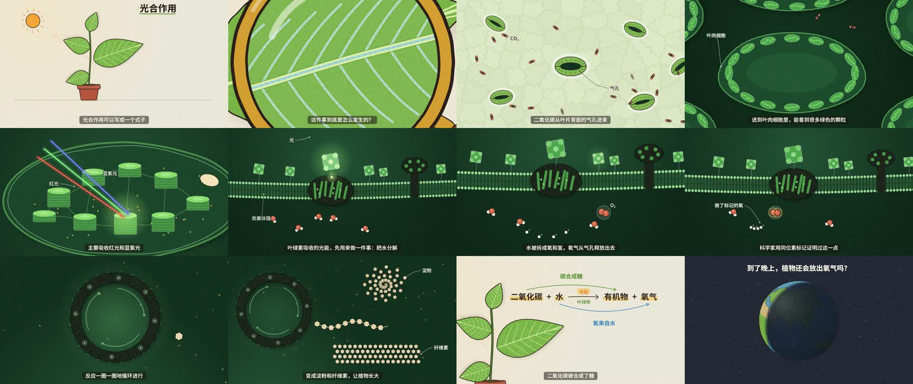

# 光合作用

一部约 2 分钟的科普短片，用一个连续的推镜，从窗台上的盆栽一路钻进叶片、气孔、叶肉细胞、叶绿体、类囊体膜，讲清楚光合作用的光反应和暗反应。最后一口气拉回盆栽，再拉远到地球。

- 画面：全部用程序绘制矢量图（skia-python），手绘质感来自抖动墨线、形状内的短排线和纸张颗粒。
- 旁白：MiniMax 语音合成（温柔学姐）。
- 配乐：原创，程序作曲。

做法参考 X 上 @devteamdrew 的《The Art of Photosynthesis》（作者注明用 Claude 制作）：

- 推镜逐层深入。
- 浅色纸底和深绿暗场两套背景。
- 用太阳能板比喻叶绿素。

完整的分析和实现过程见 [`实现思路.md`](实现思路.md)。

这是一个光合作用科普短片制作研究项目。



## 成片

前往 [v0.1.0 Release](https://github.com/SherlockGy/photosynthesis/releases/tag/v0.1.0) 下载 `photosynthesis.mp4`（约 86 MB）。三张平台封面也包含在附件中。

- 1 分 59.6 秒，1920×1080，24 fps。
- 渲染输出的原始画质：H.264 CRF 16，约 5.8 Mbps；音频 AAC 256 kbps。
- 响度 -14 LUFS，峰值约 -2.6 dBFS。

## 封面

`封面/` 下三张 PNG，按平台单独排版，不从视频里截帧：

| 文件 | 尺寸 | 平台与排版要点 |
|---|---|---|
| `封面_B站_16x9.png` | 1920×1080 | B 站；右下角留给时长角标 |
| `封面_小红书_4x3.png` | 1440×1080 | 小红书（横屏视频在信息流里按 4:3 显示） |
| `封面_抖音_9x16.png` | 1080×1920 | 抖音；关键内容放在中间 3:4 区域，避开底部文案区和右侧按钮 |

- 主题词“光合作用”做最大的主标题。
- 上方一句对观众说的话：“你呼吸的每一口氧气，是从哪儿来的？”只抛疑问，不写答案。
- 插画：一片大叶子，放大镜压在叶子上，镜片里是叶绿体内部，三道光打进基粒。
- 另有两句备选文案，在 `src/cover.py` 的 `LINES` 里：
  - b：“叶子为什么是绿色的，你真的知道吗？”
  - c：“一片叶子里面，你猜藏着什么？”
  - 换文案：`uv run python cover.py b`，输出到 `out/cover/`。

## 内容

| 段落 | 旁白要点 | 画面 |
|---|---|---|
| 开场 | 光合作用的式子；在叶子里是怎么发生的 | 盆栽、太阳、式子逐项出现；放大镜移进来，镜片里是真实放大的画面 |
| 原料 | 水沿叶脉送到各处；二氧化碳从气孔进来 | 推进镜片 → 叶脉里水在流 → 叶背表皮，气孔一张一合 |
| 叶绿体 | 叶绿体、基粒、类囊体；叶子为什么是绿的 | 钻进气孔 → 叶肉细胞 → 叶绿体；红光、蓝紫光被吸收，绿光被反射 |
| 光反应 | 光能分解水；氧气来自水（同位素标记）；ATP | 类囊体膜截面：光子打中天线，水被拆开，氧气飘走；标记过的氧走进氧气 |
| 暗反应 | 二氧化碳被固定、合成糖；卡尔文循环；淀粉和纤维素 | 平移到基质：循环转环，糖分子连成长链 |
| 收 | 回到式子 | 一口气拉回盆栽，式子上标出“氧来自水”“碳合成糖” |
| 结尾 | 到了晚上，植物还会放出氧气吗？ | 拉远到地球，昼夜交替 |

## 目录

```
README.md                     本文件
实现思路.md                    参考视频分析、画风、镜头系统、音画同步、配乐、检查、渲染
THIRD_PARTY_NOTICES.md        第三方内容声明
pyproject.toml / uv.lock      Python 依赖（用 uv 管理）
video/光合作用.mp4             本地成片（不纳入 Git，见 Release 下载）
封面/                          三个平台的 PNG 封面（16:9、4:3、9:16）
docs/preview.jpg              片中画面拼图
src/
  script.py           旁白文案（每句的段落、句后留白、多音字纠正）
  minimax.py          MiniMax 语音合成封装
  narration.py        逐句合成、裁静音、记时长
  timeline.py         时间线：96 BPM，每小节 2.5 秒，段落第一句对齐小节线
  arrange.py          编排表：每一段音乐的织体、和弦、力度、重音；作曲和画面共用
  music.py            原创作曲、渲染、混音
  draw.py             绘图工具：抖动墨线、排线（带缓存）、纸底、暗场、屏幕空间标签
  levels.py           七层场景：地球、盆栽、叶面、表皮、叶肉细胞、叶绿体、类囊体膜与基质
  scenes.py           镜头系统（层级嵌套 + 对数缩放推镜）、动作表、字幕
  render.py           预览拼图、分段并行渲染、局部重渲染、合成
  audit.py            逐帧检查（标签出画、压字幕、互相重叠）
  cover.py            封面：三个平台尺寸单独排版，文案可选 a/b/c
  style_frames.py     风格样张（早期确认画风用）
assets/
  voice/              旁白配音和时长（已合成好，不用重新配音）
  sf/                 GeneralUser GS 音源及许可证
out/                  运行时生成：混音、成片、预览、分段
```

## 运行

仓库里已经带了配音和音源。只想重新出片的话，从第 3 步开始。

```bash
uv sync
cd src
uv run python narration.py                   # 1. 旁白配音（MiniMax；文本没变的句子不重复合成）
uv run python timeline.py                    # 2. 查看时间线
uv run python music.py                       # 3. 作曲、渲染与混音 → out/mix.wav
uv run python render.py preview 5 30 60 90   # 抽几个时刻看拼图 → out/preview/sheet.jpg
uv run python audit.py 4                     # 4. 逐帧检查
uv run python render.py video 4              # 5. 渲染成片 → out/光合作用.mp4（8 核 4 进程约 8 分钟）
uv run python render.py redo 52.5 89         # 局部修改后只重渲染包含这些时刻的分段，再重新合成
uv run python render.py clip 40 55 4         # 单独渲染一段
```

- Windows 上 `uv sync` 如果报“拒绝访问”，加上 `UV_LINK_MODE=copy` 再执行；之后的 `uv run` 会自动补齐依赖。
- 进程数不要开太大：7 个进程时曾因为整机内存不足被系统停掉，16 GB 内存建议用 4 个。
- `redo` 依赖上一次整片渲染留下的 `out/chunks/` 分段，分段数必须一致（默认 16）。

## 环境与配置

- Python 3.12 以上，用 [uv](https://docs.astral.sh/uv/) 管理依赖；需要 ffmpeg。
- 字体：思源黑体可变字重版 `NotoSansSC-VF.ttf`。
  - Windows 11 自带；其他系统放到 `assets/fonts/`。
  - 也可以用环境变量 `NOTO_SANS_SC` 指定路径。
- 环境变量：

| 变量 | 用途 | 默认 |
|---|---|---|
| `SOUNDFONT_SF2` | 音源文件路径 | `assets/sf/GeneralUser-GS.sf2` |
| `NOTO_SANS_SC` | 思源黑体可变字重版的路径 | `assets/fonts/NotoSansSC-VF.ttf`，找不到用 `C:/Windows/Fonts/` |
| `MINIMAX_API_KEY` | MiniMax 语音合成的密钥（只在重新配音时需要） | 无 |
| `MINIMAX_API_BASE` | MiniMax 接口地址 | `https://api.minimax.cn` |

MiniMax 的两个变量也可以写在项目根目录的 `.env` 里。

## 做法（概要）

详细说明见 [`实现思路.md`](实现思路.md)。

- **画面**：七层场景各自在 1920×1080 的设计坐标里绘制，所有随机都由种子决定，任意时刻的画面只取决于时间。
- **镜头**
  - 子层的中心对应父层里的一个锚点：镜片中心、叶脉网眼、气孔、某颗叶绿体、某片类囊体。
  - 关键帧统一换算到根坐标后插值，缩放按对数变化，中心按“不动点”公式移动。
  - 子层透过父层的开口出现，或者在设定的缩放区间里淡入。
- **音画同步**
  - 全片网格 96 BPM，段落切换落在小节线上：光子打中叶绿素在第 20 小节，地球出现在第 43 小节。
  - 标签、气孔开合、水的分解、式子高亮，都挂在对应词说出来的时刻。
- **配乐**
  - D 大调，按画面层级设计七种织体；不用金属音色，不加音效。
  - 旁白 -16 LUFS，说话时旁白至少比配乐高 10 LU，成片 -14 LUFS。
- **检查**：逐帧检查标签出画、压字幕、互相重叠；逐帧差异检查跳帧。

## 片中科学说法的出处

1. 光合作用放出的氧气来自水：Ruben, S., Randall, M., Kamen, M., & Hyde, J. L. (1941). Heavy oxygen (O18) as a tracer in the study of photosynthesis. *Journal of the American Chemical Society*, 63(3), 877–879.
2. 卡尔文循环：Calvin, M. (1961). The path of carbon in photosynthesis. Nobel Lecture.
3. 叶绿素主要吸收红光和蓝紫光、绿光吸收最少，以及光反应和暗反应的划分：中学生物教材里光合作用的章节（具体版本与章节待确认）。

## 素材与授权

- 画面：程序绘制。
- 配乐：原创，程序生成。
- 配音：AI 生成（MiniMax）。
- 音源：GeneralUser GS，作者 S. Christian Collins，许可证见 `assets/sf/GeneralUser-GS-LICENSE.txt`。
- 字体：思源黑体（SIL OFL），系统字体，未随项目分发。
